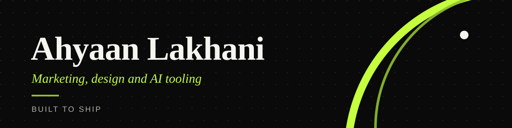

  

<h3 align="center">Marketing, design, and the tools that make the work repeatable.</h3>

  

---

## 👋 About

I take a brief from idea to published, on a deadline, and then build the small tools that make the next one faster.

- 🚀 **Now:** Founder and CEO, Innovator Pakistan (since 2023)
- 🎓 **Also:** Marketing and design for student societies at IBA
- 🧠 **Working on:** AI agents with clear limits and visible behaviour, and event tooling for local communities
- 📈 **Background:** Ten roles since 2021, mostly in marketing departments and NGO teams

---

## 📊 Activity

  

---

## 🛠 What I do

| Area | Work |
|---|---|
| ✍️ **Content** | Social campaigns, reels, carousels, and captions, delivered start to finish |
| 🎨 **Design** | Brand assets and posters for organisations with no design budget |
| 🎬 **Events** | Coverage on the day, then editing and animation afterwards |
| ⚙️ **Engineering** | Python tools, agent workflows with strict tool validation, and evaluation traces |

---

## 🧰 Toolkit

**Design and content**

**Engineering**

---

## 🏆 Highlights

- 1,000,000+ impressions across the campaign work of a flagship event team
- Marketing across four student society departments within a single year
- Built and marketed a student brand from zero to around 200 Instagram followers

---

## 📍 Experience

| When | Role |
|---|---|
| 2023 to now | **Founder and CEO**, Innovator Pakistan |
| 2024 to 2025 | **Co-Director, Graphics**, Under The Radar |
| 2023 to 2025 | **Marketing Executive**, Lytech |
| 2021 to 2025 | **Marketing and volunteer roles** at NGO teams, including An Nahl, Tehreek, and Roshni |

---

## 📫 Get in touch

Open to marketing, design, and AI-tooling work.

